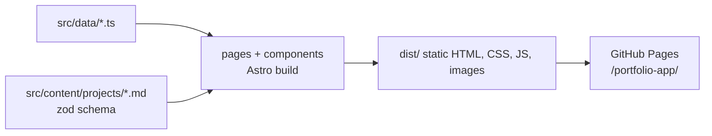

# System Architecture

## Overview

Fully static site. No server runtime, no API. Astro renders HTML at build; a small client bundle adds motion (GSAP) and the mobile menu.



## Build pipeline

1. `astro build` loads the `projects` collection (`src/content.config.ts`), validating frontmatter (summary <=160, `coverAlt` required with `cover`). Invalid content fails the build.
2. `src/pages/index.astro` renders six sections; `src/pages/projects/[slug].astro` emits one page per entry (`getStaticPaths`, slug = file name); `404.astro` emits `404.html`.
3. `astro:assets` optimizes cover images; Fontsource CSS/woff2 bundled (no external requests).
4. Output in `dist/` under base `/portfolio-app`.

## Page / component tree

```
BaseLayout (head SEO + root-flag script + ClientRouter)
├── SkipToContentLink
├── SiteHeader (logo initials, nav, menu toggle)  -> scripts/mobile-menu.ts
├── <main id="main">
│   ├── index: Hero > About > Skills > Projects(ProjectCard*) > Experience > Contact
│   ├── projects/[slug]: back link, header, TagList, cover, markdown prose
│   └── 404: "Signal lost" + NeonButton home
├── SiteFooter
└── scripts/animations/init-animations.ts
```

`base-layout.astro` props: `title`, `description`, `ogImage`, `noindex` (omits canonical, adds `robots noindex`; used by 404).

## Root flags (progressive enhancement)

Inline `<head>` script sets flags on `<html>` before first paint:

| Flag | Set by | Meaning | Removed when |
|------|--------|---------|--------------|
| `data-motion="ok"` | head script, only if `prefers-reduced-motion: no-preference` | CSS pre-hides `[data-reveal]`, `[data-hero]` | JS skips/fails, user prefers reduce, or failsafe fires |
| `data-menu-enhanced` | head script | Mobile nav collapses behind toggle | Failsafe fires |
| `data-motion-ready` | `init-animations.ts` | Animations took over | never (checked by failsafe) |
| `data-menu-ready` | `mobile-menu.ts` | Menu JS bound | never (checked by failsafe) |

Failsafe: 3s after setting flags, head script deletes `data-motion` unless `data-motion-ready` exists, and `data-menu-enhanced` unless `data-menu-ready` exists. So a failed/slow bundle never leaves content hidden or nav collapsed with no toggle. JS disabled entirely: head script never runs, no flags, so content and nav are always visible.

`ClientRouter` swaps replace `<html>` attributes, so the head script re-runs `setRootFlags` on `astro:after-swap`.

## Animation lifecycle

```mermaid
sequenceDiagram
  participant Head as head inline script
  participant Router as ClientRouter
  participant Anim as init-animations
  participant Menu as mobile-menu
  participant CSS as global-styles.css
  Head->>Head: set data-menu-enhanced; data-motion=ok if no reduced-motion
  Head->>Head: start 3s failsafe timer
  CSS->>CSS: html[data-motion=ok] pre-hides data-reveal / data-hero
  Router->>Anim: astro:page-load -> init (cleanup first, idempotent)
  Anim->>Anim: bind card spotlight
  Anim->>Anim: no-preference branch: heroTextReveal + scrollReveals (SplitText, ScrollTrigger)
  Anim->>Head: set data-motion-ready
  Router->>Menu: astro:page-load -> bind toggle, set data-menu-ready
  Head-->>Head: 3s: flag without matching ready flag is removed
  Router->>Anim: astro:before-swap -> mm.revert() + unbind spotlight
  Router->>Head: astro:after-swap -> re-set flags, new failsafe
  Anim->>Anim: reduce branch fires if user switches mid-session -> remove data-motion
```

Details:
- `init` skips motion (only sets `data-motion-ready`) if the failsafe already removed `data-motion`, so content is not re-hidden.
- On init error: logs, removes `data-motion`, content shows.
- Reveals use `opacity` + `y` (not `autoAlpha`) to keep content in the a11y tree.
- No CSS `scroll-behavior: smooth`; deep links and reload restore land correctly.
- Hero title: `SplitText` with `autoSplit` re-splits on font load / resize.

## Routing and base path

- `base: '/portfolio-app'`, `trailingSlash: 'ignore'`.
- Internal links use `withBasePath()`; `ClientRouter` handles soft navigation (view transitions with `transition:name` on project title/cover).
- Hash links in header nav (`/portfolio-app/#about`) work from any page.

## SEO

Canonical + Open Graph + Twitter card built from `Astro.site` + pathname; default image `public/og-image.png`. 404 is `noindex` without canonical.

## CI/CD

```
PR or push -> verify (npm ci, check, e2e)
push to main -> build (withastro/action) -> deploy (deploy-pages) -> Pages
```

See [deployment-guide.md](deployment-guide.md).

## Key decisions

| Decision | Why |
|----------|-----|
| Static Astro, no UI framework | Minimal JS, fast LCP, simple hosting |
| Plain CSS tokens | No extra build deps; one token file shared by all styles |
| GSAP + `gsap.matchMedia()` | One revert point for reduced-motion + route changes |
| Failsafe flags | Content can never get stuck hidden |
| Tests against production build | Catches base-path + bundling bugs |
