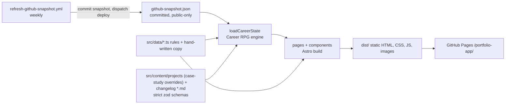
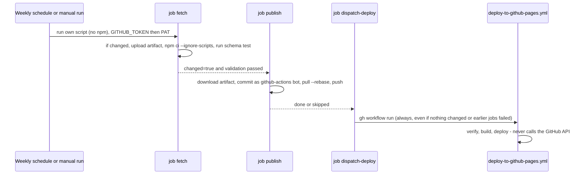
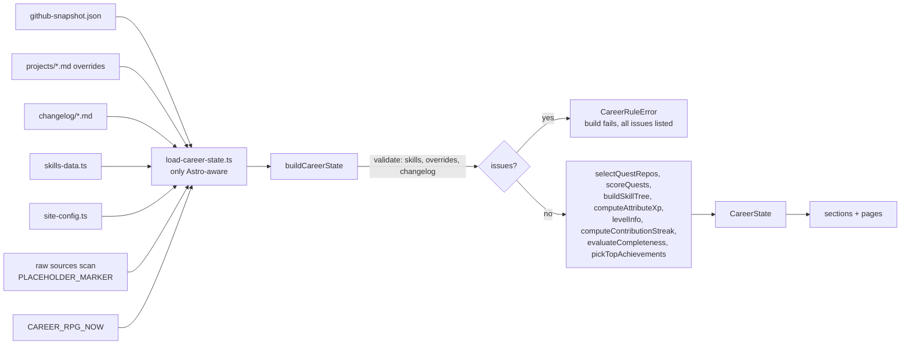

# System Architecture

## Overview

Fully static site. No server runtime, no API, no network at build. Astro renders HTML at build; a small client bundle adds motion (GSAP) and the mobile menu. The avatar is composed at build time and the server render is zero-JS; the optional class/job switcher adds one small eager script and a lazy chunk ([Class/job switcher](#classjob-switcher)).



GitHub data enters only through the committed snapshot; see [GitHub-derived pipeline](#github-derived-pipeline).

## Build pipeline

1. `astro build` loads the `projects` (case-study overrides) and `changelog` collections (`src/content.config.ts`, strict zod: unknown keys fail; summary <=160, `coverAlt` required with `cover`) and strict-parses the snapshot (`github-snapshot-schema.ts`). Invalid content fails the build.
2. `loadCareerState()` runs cross-entry rules + scoring once per build ([Career RPG pipeline](#career-rpg-pipeline)); a rule violation throws `CareerRuleError` and fails the build.
3. `src/pages/index.astro` renders seven sections; `src/pages/projects/[slug].astro` emits one page per quest (`getStaticPaths`, slug = repo slug); `speedrun.astro`, `changelog.astro`, `credits.astro`, `404.astro` emit their pages.
4. `astro:assets` optimizes cover images; Fontsource CSS/woff2 bundled (no external requests).
5. Output in `dist/` under base `/portfolio-app`.

## Page / component tree

```
BaseLayout (head SEO + ThemeHeadScript + root-flag script + ClientRouter)
├── SkipToContentLink
├── SiteHeader (logo initials, nav, HeaderControls = ThemeToggle + MenuToggleButton)  -> scripts/mobile-menu.ts
├── <main id="main">
│   ├── index: Hero (CharacterAvatar 256 + CharacterNameplate + GithubDataNote; hero and sheet avatar + nameplate are `switchable`) > About > CharacterSheet (CharacterPortraitPanel: avatar 192, ClassJobSwitcher, GearLegend, ClassWhyPanel) > Skills(tree) > Projects(ProjectCard*) > Experience > Contact
│   ├── projects/[slug]: back link, header, TagList, cover, BossBattlePanel (quest log), markdown prose (override body, if any)
│   ├── speedrun: SpeedrunCharacterHeader (avatar 128), availability, AchievementCard*, contact CTAs, decorative countdown
│   ├── changelog: StreakBadge, entries newest first
│   ├── credits: fonts, icons (PixelIconGallery), AvatarGallery (10 looks + gear tier ramp), libraries + licenses
│   └── 404: "Off the map" + NeonButton home
├── SiteFooter
└── scripts/animations/init-animations.ts
```

`base-layout.astro` props: `title`, `description`, `ogImage`, `noindex` (omits canonical, adds `robots noindex`; used by 404).

## GitHub-derived pipeline

Data, classifier and avatar. Numbers live in the rules files (link, don't copy): `src/data/character-class-rules.ts`, `character-job-rules.ts`, `gear-rules.ts`, `skills-data.ts`, `xp-rules.ts`.

```mermaid
flowchart LR
  A[GitHub GraphQL<br/>public repos + contribution weeks] --> F[scripts/fetch-github-snapshot.ts<br/>own code, no npm deps]
  F --> N[normalize-snapshot.ts<br/>public non-fork only, ISO-week dates, sorted]
  N --> J[github-snapshot.json]
  J --> L[load-career-state.ts<br/>strict zod parse]
  L --> K[classify-character<br/>class (domain), job, gear tiers, why signals]
  L --> Q[repo-quests + repo-skill-matches<br/>quests, skill evidence]
  L --> T[contribution streak]
  K --> V[select-avatar-layers<br/>compose 32x32 grid<br/>sticker ring, merged paths]
  V --> I[character-avatar.astro<br/>inline SVG]
  K --> U[hero, sheet, speedrun, credits]
  Q --> U
  T --> U
  I --> U
```

### Class and job model

Single source of truth; other docs link here. Values live in `character-class-rules.ts` and `character-job-rules.ts`.

- **Vote:** a repo proves skills (`repo-skill-matches.ts`: `match` rules in `skills-data.ts`: language share, topic, keyword, root file, workflow). Only skills in `skillDomains` vote, each for one domain. The repo splits its weight evenly across the domains of the voting skills it proves; weight = recency (half-life, floor) x owner activity x archived factor.
- **Class = domain:** highest summed score wins, ties in order backend, frontend, devops. Backend = Warrior, Frontend = Archer, DevOps = Mage. Adventurer (no job) when the total vote or the number of voting repos is under the fallback minimum.
- **Job = specific skills:** 3 per class; every voting skill is in exactly one job (unit-tested). Job credit = summed primary-domain vote of the voting repos that prove at least one job skill; highest wins, ties go to the earlier job. Each job has its own prop, accent colour and motion (keyed by job id).
- **Languages alone mostly don't vote:** Python, TypeScript, JavaScript, Go, Rust and Swift alone vote for nothing. A repo must prove a domain skill: keyword, topic, root file, workflow, or a listed language (C#, Java, HTML, CSS, Astro).
- **Evidence:** `signals` = repos for the primary domain (max 5), `jobSignals` = repos for the job (max 2); the Why panel shows both lists.
- **Quests are class-independent:** score = repo weight + hygiene + pinned, so Python-only repos still rank.

| Class (domain) | Job: skills (prop) |
|----------------|-------------------------|
| Warrior (backend) | Knight: csharp, dotnet (crest shield) · Paladin: java, spring (sword + spring leaves) · Sentinel: web-servers (server watchtower) |
| Archer (frontend) | Ranger: react, astro (two-orbit atom) · Skirmisher: mobile (winged phone) · Herald: web-sites, html, css (horn + code pennant) |
| Mage (devops) | Enchanter: github-actions, jenkins (rune pipeline) · Summoner: docker (container crate) · Seer: playwright (floating eye) |

### Modules

| Area | Where | Notes |
|------|-------|-------|
| Fetch | `scripts/fetch-github-snapshot.ts`, `scripts/github-snapshot/*` | GraphQL; `GITHUB_TOKEN`, then optional `GH_SNAPSHOT_PAT`; pages of 25 then 10 on non-auth failure; contribution windows of 365 days back to account creation (~8 points per run); >300 repos = refuse. Never fails the job: no token or any error keeps the file, warns, exits 0. Writes only on change; sets `changed` output |
| Normalize | `src/utils/github-character/normalize-snapshot.ts` | Drops private/fork repos (also from pinned and activity), keeps only https URLs, rounds dates to ISO-week Monday, sorts; `asOf` = ISO-week Monday so unchanged data = identical bytes |
| Schema | `src/data/github/github-snapshot-schema.ts` | Strict zod; validated in the workflow (separate step) and on every build |
| Classifier | `src/utils/github-character/{classify-character,repo-domain-vote,repo-tokens}.ts` | Model above. `repo-domain-vote` = one repo's weighted vote (also exports `repoWeight`); `classify-character` ranks domains, picks the job, builds `signals` + `jobSignals` (pure). Scores rounded to 3 decimals; deterministic tie-breaks |
| Gear | `src/utils/github-character/gear-tiers.ts` | Per slot, repos showing the hygiene signal (root/`.github`/workflow file names) -> tier 0-3 by thresholds. Known blind spot: tests below the repo root |
| Quests | `repo-quests.ts` | Score = repo weight + hygiene bonus + pinned bonus (class-independent); top `quest.max` plus override repos. Difficulty by owner commits or code KiB. Boss = override `isBoss`, else first pinned, else top-ranked |
| Skills | `repo-skill-matches.ts`, `skills-data.ts` | A repo matches a node by language share, topic, keyword, root file or workflows. Evidence = distinct matching repos (no hand evidence). The same matches decide the class |
| Avatar | `src/data/avatar/*`, `src/utils/avatar/*` | See below |

### Avatar render

- Data: hand-authored grids (`src/data/avatar/`): one 2-frame pose per class (4: Warrior, Archer, Mage, Adventurer), 2-frame job prop per job id (9: `avatar-job-props-{warrior,archer,mage}.ts`, each inside its class zone `JOB_PROP_ZONES`), outfit trim masks per class (`avatar-class-trim.ts`), 4 tiers per gear slot (4). Registry `avatar-sprites.ts`; palette keys -> `--avatar-*` tokens (`avatar-palette.ts`); the 9 job accents (keys A B C D E F H J M, `JOB_ACCENT`) are `--avatar-accent-<job>` tokens, same hex in both themes.
- `select-avatar-layers.ts` places sprites at per-frame pose anchors in slots `base < class < trim < armor < amulet < boots < shield < job < fx` (`LAYER_Z`). Props sit at fixed coordinates in the class zone; `trim` repaints part of the outfit in the job's accent (Adventurer: no trim, no prop).
- `compose-avatar-grid.ts` (pure): last opaque pixel wins, outside pixels clipped. `avatar-sticker-outline.ts` pads, adds outline then sticker ring. `avatarPaths` (+ `gridToMergedPathData` in `pixel-icon-path.ts`) emits one rect-merged `<path>` per palette key.
- `character-avatar.astro` inlines the SVG (`role=img`, name "Class · Job", desc = gear). Animated variant holds both frames; CSS toggles them, 5 loops x 900ms (~4.5s) then rests on frame A, only under `html[data-motion=ok]` and no reduced motion. `forced-color-adjust: none` on the art.
- Sizes: art box 128 / 192 / 256 px (4/6/8 px per art pixel) plus 2px sticker margin. Used: hero 256, sheet 192, speedrun 128, `/credits/` gallery 128.
- Budgets (unit-tested): <= 16 colors + ring; static <= 6 KB raw; animated <= 11 KB raw, <= 2.5 KB gzip. Measured v1.6 max: 15 colors, 10,886 B raw (Archer · Ranger tier 3), 1,979 B gzip.
- The server render always shows the look derived from GitHub ("GitHub pick"). Gear tiers are a function of the snapshot only (`gear = f(snapshot)`); the displayed class/job is a function of the visitor (`look = f(visitor)`, default = GitHub pick). Gear is drawn on every look.

### Class/job switcher

Visitor may display any of 10 looks (Warrior/Archer/Mage x their 3 jobs, plus Adventurer, which has no job). A look key is `class/jobId` (e.g. `mage/seer`, `adventurer`); the radio value is the job id. Picking another class keeps the job slot (1st/2nd/3rd), not the job (Warrior · Sentinel -> Archer · Herald -> Mage · Seer; helpers `jobSlot`/`jobAtSlot`, `changeClass`). Changes the hero + character-sheet avatar and name only. Attributes, the `Why <Class>?` panel, `/speedrun/` and `/credits/` keep the GitHub-derived class (roadmap follow-ups). Server HTML stays zero-JS for the avatar; switching re-composes in the browser from the SAME pure modules (`select-avatar-layers`, `compose-avatar-grid`, `avatar-svg-paths`), so output cannot drift from the build.

| Piece | Where | Loaded |
|-------|-------|--------|
| Look list, keys, parse, moves | `src/utils/avatar/class-looks.ts` (pure; `allClassLooks`, `lookProfile`, `parseLookKey`) | eager (stub) |
| Display strings | `src/utils/avatar/class-labels.ts` | eager (stub) |
| Look -> frames/title/desc | `src/utils/avatar/look-avatar-model.ts` (pure; takes gear tiers from the snapshot) | lazy chunk |
| DOM applier | `src/scripts/look-apply-model.ts` | lazy chunk |
| Stub: state, storage, lifecycle | `src/scripts/class-job-switcher.ts` | eager, from `class-job-switcher.astro` |
| Radio groups | `src/scripts/switcher-body.ts` (built on first open, keeps HTML small) | eager (stub) |

Hooks: `data-look` (control root, carries `data-default-look` and `data-gear`), `data-look-avatar`, `data-look-name`, `data-look-class`, `data-look-job`.

```mermaid
sequenceDiagram
  participant V as Visitor
  participant S as eager stub (class-job-switcher.ts)
  participant L as lazy chunk (look-apply-model.ts)
  participant D as DOM (hero + sheet)
  S->>S: astro:page-load -> bind, read portfolio-look (allow-list parse)
  alt saved look differs from GitHub pick
    S->>L: import() on load
    L->>D: re-compose frames, swap title/desc/g, update names
  end
  V->>S: open details (first time)
  S->>S: build radio groups; start import()
  V->>S: pick class / job / Reset
  S->>L: renderLook(key, gear)
  L->>D: swap SVG title, desc, frame groups; names
  L-->>S: done
  S->>S: save key (removed when equal to pick), set polite status
  Note over S,L: import() failure: control reverts and says "Couldn't switch class. Showing the GitHub pick." until reload (browser caches the failed import)
```

- Lifecycle: bind on `astro:page-load`, abort (`AbortController`) on `astro:before-swap`; a stale in-flight import is ignored via a token. Rule list: [code-standards.md](code-standards.md#classjob-switcher).
- Saved choice: `localStorage` key `portfolio-look`, value = allow-listed look key (e.g. `mage/seer`). Removed on Reset and when it equals the GitHub pick; invalid value (including keys from before v1.6 such as `mage/hawk`, `warrior/banner`, or v1.4 `mage/data`) or blocked storage is ignored, so a visitor with an old saved look falls back to the GitHub pick once (the choice then lasts for the page). Per browser only; nothing is sent anywhere.
- Progressive enhancement: control markup is in the server HTML but hidden until the stub sets `data-ready` on it (a control-local attribute, not a root flag), and `@media (scripting: none)` removes it. No JS or a failed bundle = GitHub pick only, nothing broken.
- Motion: the replacement frame `<g>` elements restart the CSS loop on the new frames under the same gating (`data-motion=ok`, no reduced motion).
- Measured (v1.6): no chunk request before first open (or load with a saved look); eager stub 7,010 B raw / 3,034 B gzip (v1.5: 6,944 / 2,992; budget <= +100 gz); lazy chunk 20,913 B raw / 5,421 B gzip (v1.5: 18,040 / 4,580; budget <= 23,000 / 6,000); home HTML 112,667 B raw / 13,629 B gzip (v1.5: 111,756 / 13,515; budget <= +1,000 gz); `/credits/` HTML 102,661 B raw / 13,391 B gzip (v1.5: 99,691 / 12,832). v1.4 compose + apply was 10-14 ms warm at 4x CPU throttle (not re-measured).

### Refresh and deploy sequence



- Why dispatch: commits pushed with `GITHUB_TOKEN` do not trigger `push` workflows. The dispatch also gives the weekly rebuild (streak/HUD depend on build date), so the deploy workflow has no cron of its own.
- Trust split: the token-bearing step runs only our dependency-free script. The npm install (`--ignore-scripts`, no secrets in env) and schema test run after the artifact is uploaded; they can only fail the job (publish skips). `publish` has no npm; `contents: write` only there, `actions: write` only in `dispatch-deploy`.
- `dry_run_no_token` input exercises the keep-snapshot fallback.

## Career RPG pipeline

Everything gamified is derived at build time; there is no runtime state. Rules and weights live only in `src/data/xp-rules.ts` (link, don't copy numbers into docs).



- `load-career-state.ts` (the only module with `astro:*` / `import.meta.env`): strict-parses the snapshot and `skillNodes`, `getCollection` -> override + changelog inputs, `import.meta.glob(?raw)` scan for the placeholder marker (flags an override `isSample`, feeds HUD), reads `CAREER_RPG_NOW`. Memoized per build (all pages share one state); uncached in dev; cache reset on error so a fixed file recovers.
- `buildCareerState()` is pure: same inputs => same state. Validates first, then scores; all violations aggregate into one `CareerRuleError`.
- `CAREER_RPG_NOW=YYYY-MM-DD` pins build time to the end of that UTC day (reproduce a past streak/HUD); invalid value throws. Unset => real time.
- e2e expectations are computed by the same pure modules from the snapshot + override files (`tests/e2e/career-mirror.ts`), not hardcoded.

### Scoring summary

| Piece | Rule (values in `xp-rules.ts`) |
|-------|-------------------------------|
| Quest XP | `baseXp[difficulty]` x (1 + earned bonuses). Difficulty from owner commits / code KiB. Bonuses from repo facts (description, homepage, tests, CI) and override (case study when body >= `minBodyWords` + `minUniqueWords`, metrics, obstacles), boss. No override = status `derived`, still earns XP |
| Tier | Nth best quest in a tier earns raw x `tierDecay`^N; tier total scaled to `tierCap` |
| Skill node | Each matching public repo `xpPerRepo`, decayed by `decay`, capped `nodeCap`. Level = `levelThresholds` reached by distinct matching repos (own matches + quests, rolled up from children) |
| Attributes | 4 (`ATTRIBUTE_IDS`): quest XP split evenly across the quest's skills' attributes (none matched: `fallbackAttribute`) + node XP; each clamped to `attributeCap` |
| Level / title | Total XP -> `base*(L-1)^exponent`, max level; title = highest band reached |
| Streak | Consecutive ISO weeks (UTC) with >= `streak.minWeeklyContributions` GitHub contributions in the snapshot; empty current week doesn't break it yet |
| HUD | 10 pass/fail checks: no placeholder files, real email, bio length, availability note, socials, snapshot fresh (`maxSnapshotAgeDays`), every quest repo has description, every quest repo has topics, boss has case study, streak alive |
| Speedrun | Metrics of quests (boss first, then featured by XP), round-robin, top `speedrun.achievements` |

### Build-failing rules

Unknown/hand-set keys in overrides, skill nodes or snapshot (`xp`, `level`, `difficulty`, `skills`, `evidence`, `repoUrl`); non-https or credentialed URL; schema-invalid snapshot; empty snapshot; override file name matching no snapshot repo; more than one `isBoss` override; two repos sharing a slug; skill id not kebab-case, unknown attribute/parent, parent cycle; changelog date > build time + `futureToleranceHours`.

### Anti-gaming and honesty

- XP comes from public repo facts and the rules file, not from claims. Class and gear rules are generic and tested on fixture profiles; per-owner hardcodes are not allowed. Each repo votes once and recency-weights, and a repo must prove a domain skill to vote (a language like Python or TypeScript alone doesn't), so one big or recently pushed repo can't decide the class alone.
- Linguist noise (agent tooling, docs) is excluded in the repo via `.gitattributes` (`.claude/**` vendored, `plans/**` and `docs/**` documentation), so the character reflects the site code.
- Case-study word minimum counts prose only (code, URLs, hidden elements, link definitions excluded) plus a distinct-word minimum.
- Tier decay + caps and the attribute cap make many small repos worth less than a few real ones.
- Still self-attested: override text and metrics, changelog dates. Repo facts can be gamed by creating repos (no ownership/quality check beyond public GitHub data). See [project-roadmap.md](project-roadmap.md#known-limitations).

## Root flags (progressive enhancement)

Inline `<head>` script sets flags on `<html>` before first paint:

| Flag | Set by | Meaning | Removed when |
|------|--------|---------|--------------|
| `data-theme="light\|dark"` | `theme-head-script.astro` (sole writer), always when JS runs | Forces `color-scheme`; absent = no JS, CSS follows system and toggle hides | never (re-set on swap) |
| `data-motion="ok"` | head script, only if `prefers-reduced-motion: no-preference` | CSS pre-hides `[data-reveal]`, `[data-hero]` | JS skips/fails, user prefers reduce, or failsafe fires |
| `data-menu-enhanced` | head script | Mobile nav collapses behind toggle | Failsafe fires |
| `data-motion-ready` | `init-animations.ts` | Animations took over | never (checked by failsafe) |
| `data-menu-ready` | `mobile-menu.ts` | Menu JS bound | never (checked by failsafe) |

The class/job switcher does not use a root flag: it sets `data-ready` on its own `<details data-look>`, which only reveals the control. It never hides content, so the failsafe does not cover it.

`data-theme` is a root flag too but is not part of the failsafe: it is cosmetic and never hides content.

Failsafe: 3s after setting flags, head script deletes `data-motion` unless `data-motion-ready` exists, and `data-menu-enhanced` unless `data-menu-ready` exists. So a failed/slow bundle never leaves content hidden or nav collapsed with no toggle. JS disabled entirely: head script never runs, no flags, so content and nav are always visible.

`ClientRouter` swaps replace `<html>` attributes, so the head script re-runs `setRootFlags` on `astro:after-swap`.

## Theme lifecycle

Colors are `light-dark()` tokens ([design-guidelines.md](design-guidelines.md#theme-and-color)); the only runtime piece is `theme-head-script.astro`.

```mermaid
sequenceDiagram
  participant Head as theme head script
  participant Router as ClientRouter
  participant Btn as [data-theme-toggle]
  Head->>Head: head parse: theme = stored (rpg-theme) or system; set html[data-theme] + theme-color metas
  Router->>Head: astro:before-swap -> copy data-theme to newDocument root
  Router->>Head: astro:after-swap -> re-apply, refresh aria-pressed
  Btn->>Head: click (delegated) -> flip, persist (try/catch, in-memory fallback), apply
  Head-->>Head: system scheme change -> follow only while no stored choice
```

- No JS: no `data-theme`; CSS follows `prefers-color-scheme`, toggle hidden.
- Storage blocked: choice lasts for the tab.
- No `light-dark()` support: dark-only fallback tokens, toggle hidden.

## Animation lifecycle

```mermaid
sequenceDiagram
  participant Head as head inline script
  participant Router as ClientRouter
  participant Anim as init-animations
  participant Menu as mobile-menu
  participant CSS as global-styles.css
  Head->>Head: set data-menu-enhanced; data-motion=ok if no reduced-motion
  Head->>Head: start 3s failsafe timer
  CSS->>CSS: html[data-motion=ok] pre-hides data-reveal / data-hero
  Router->>Anim: astro:page-load -> init (cleanup first, idempotent)
  Anim->>Anim: bind card spotlight
  Anim->>Anim: no-preference branch: heroTextReveal + scrollReveals (SplitText, ScrollTrigger)
  Anim->>Head: set data-motion-ready
  Router->>Menu: astro:page-load -> bind toggle, set data-menu-ready
  Head-->>Head: 3s: flag without matching ready flag is removed
  Router->>Anim: astro:before-swap -> mm.revert() + unbind spotlight
  Router->>Head: astro:after-swap -> re-set flags, new failsafe
  Anim->>Anim: reduce branch fires if user switches mid-session -> remove data-motion
```

Details:
- `init` skips motion (only sets `data-motion-ready`) if the failsafe already removed `data-motion`, so content is not re-hidden.
- On init error: logs, removes `data-motion`, content shows.
- Reveals use `opacity` + `y` (not `autoAlpha`) to keep content in the a11y tree.
- No CSS `scroll-behavior: smooth`; deep links and reload restore land correctly.
- Hero title: `SplitText` with `autoSplit` re-splits on font load / resize.

## Routing and base path

- `base: '/portfolio-app'`, `trailingSlash: 'ignore'`.
- Pages: `/`, `/projects/<repo-slug>/`, `/speedrun/`, `/changelog/`, `/credits/`, 404 ("Off the map", noindex). Header nav has "Speedrun"; hero CTA "60s recruiter view"; footer has "Changelog" and "Credits".
- Internal links use `withBasePath()`; `ClientRouter` handles soft navigation (view transitions with `transition:name` on project title/cover).
- Hash links in header nav (`/portfolio-app/#about`) work from any page.

## SEO

Canonical + Open Graph + Twitter card built from `Astro.site` + pathname; default image `public/og-image.png`. 404 is `noindex` without canonical.

## CI/CD

```
PR or push -> verify (npm ci, check, unit, e2e)
push to master -> build (withastro/action) -> deploy (deploy-pages) -> Pages
weekly cron (Mon 02:47 UTC) refresh-github-snapshot.yml -> commit snapshot if changed -> dispatch deploy on master
```

See [deployment-guide.md](deployment-guide.md).

## Key decisions

| Decision | Why |
|----------|-----|
| Static Astro, no UI framework | Minimal JS, fast LCP, simple hosting |
| Plain CSS tokens | No extra build deps; one token file shared by all styles |
| `light-dark()` tokens + head script | Light/dark with no flash and no per-theme CSS; works without JS (system scheme) |
| Inline SVG pixel icons from TS grids | No downloads or sprite requests, `currentColor` theming, unit-testable |
| GSAP + `gsap.matchMedia()` | One revert point for reduced-motion + route changes |
| Failsafe flags | Content can never get stuck hidden |
| Tests against production build | Catches base-path + bundling bugs |
| Compute XP at build, evidence-only | No backend; nothing hand-set can inflate the score; strict schemas fail loudly |
| Pure engine + thin Astro loader | Scoring unit-tested with `node --test` (no Astro); one memoized state per build |
| Committed snapshot as the only data input | Offline, deterministic builds and tests; reviewable data diffs; no secret at build time |
| Refresh in its own workflow, dispatch the deploy | `GITHUB_TOKEN` pushes don't trigger `push` workflows; the dispatch doubles as the weekly rebuild; deploy never touches the GitHub API |
| Token step runs only our no-dependency script | Write token never shares a job with third-party npm code |
| Refresh never fails the run | Stale data beats a broken weekly deploy; the HUD flags a stale snapshot |
| Data-driven, generic classifier + fixtures | Honesty rule: no per-owner hardcode; rule changes must keep other profiles' classes |
| Class from skill matches, job from skills | The class follows what the code does (backend/frontend/devops), reusing the skill tree's evidence instead of a second language/keyword table. Python/TypeScript alone don't vote; each voting skill is in exactly one job, so any vote can name a job. Mage = DevOps (no data skills exist to earn a Data class) |
| Hand-authored sprites composed to inline SVG | Server render is zero-JS, no asset requests, token-driven palette (themeable ring), unit-testable layers |
| CSS-only bounded action loop | Meets WCAG 2.2.2 (stops), honours reduced motion, no JS |
| Switcher composes in the browser on demand | Inlining 10 looks costs ~7.8 KB gzip on every home load; per-look files cost more in total. A lazy chunk (5.4 KB gzip) is fetched only on first open or with a saved look, and reuses the build's pure modules, so no drift |
| Choice persisted per browser, derived pick is the default | `localStorage` only (no server, no tracking); fresh and no-JS visitors see the GitHub pick; Reset clears the key |
| Gear independent of class/job | Gear tiers stay a function of the GitHub snapshot; a visitor picks a look, never gear, and class/job/gear/XP are still never hand-set |
