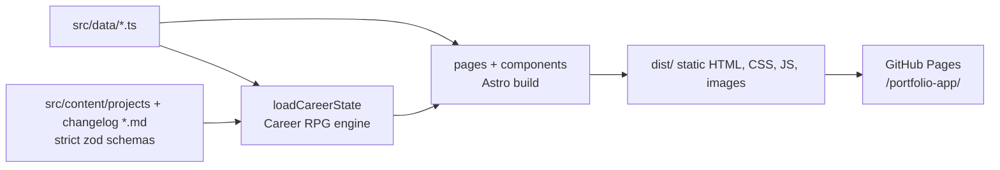
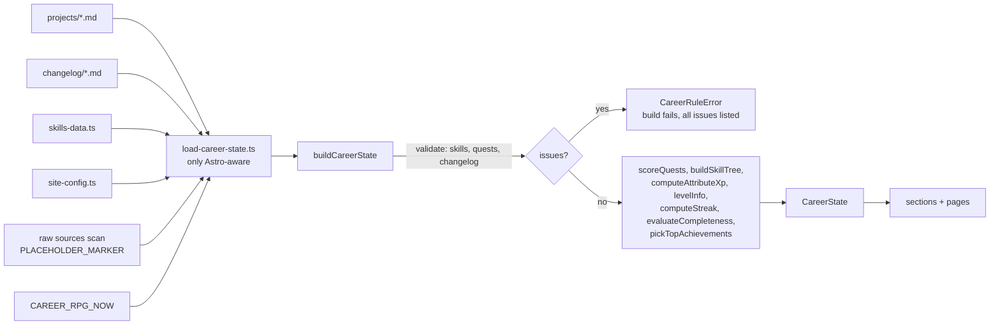

# System Architecture

## Overview

Fully static site. No server runtime, no API. Astro renders HTML at build; a small client bundle adds motion (GSAP) and the mobile menu.



## Build pipeline

1. `astro build` loads the `projects` and `changelog` collections (`src/content.config.ts`, strict zod: unknown keys fail; summary <=160, `coverAlt` required with `cover`, boss needs metric + obstacle). Invalid content fails the build.
2. `loadCareerState()` runs cross-entry rules + scoring once per build ([Career RPG pipeline](#career-rpg-pipeline)); a rule violation throws `CareerRuleError` and fails the build.
3. `src/pages/index.astro` renders seven sections; `src/pages/projects/[slug].astro` emits one page per entry (`getStaticPaths`, slug = file name); `speedrun.astro`, `changelog.astro`, `credits.astro`, `404.astro` emit their pages.
4. `astro:assets` optimizes cover images; Fontsource CSS/woff2 bundled (no external requests).
5. Output in `dist/` under base `/portfolio-app`.

## Page / component tree

```
BaseLayout (head SEO + ThemeHeadScript + root-flag script + ClientRouter)
├── SkipToContentLink
├── SiteHeader (logo initials, nav, HeaderControls = ThemeToggle + MenuToggleButton)  -> scripts/mobile-menu.ts
├── <main id="main">
│   ├── index: Hero > About > CharacterSheet > Skills(tree) > Projects(ProjectCard*) > Experience > Contact
│   ├── projects/[slug]: back link, header, TagList, cover, BossBattlePanel (quest log), markdown prose
│   ├── speedrun: availability, AchievementCard*, contact CTAs, decorative countdown
│   ├── changelog: StreakBadge, entries newest first
│   ├── credits: fonts, icons (PixelIconGallery), libraries + licenses
│   └── 404: "Off the map" + NeonButton home
├── SiteFooter
└── scripts/animations/init-animations.ts
```

`base-layout.astro` props: `title`, `description`, `ogImage`, `noindex` (omits canonical, adds `robots noindex`; used by 404).

## Career RPG pipeline

Everything gamified is derived at build time; there is no runtime state. Rules and weights live only in `src/data/xp-rules.ts` (link, don't copy numbers into docs).



- `load-career-state.ts` (the only module with `astro:*` / `import.meta.env`): `getCollection` -> inputs, `import.meta.glob(?raw)` scan for the placeholder marker (flags a quest `isSample`, feeds HUD), strict-parses `skillNodes`, reads `CAREER_RPG_NOW`. Memoized per build (all pages share one state); uncached in dev; cache reset on error so a fixed file recovers.
- `buildCareerState()` is pure: same inputs => same state. Validates first, then scores; all violations aggregate into one `CareerRuleError`.
- `CAREER_RPG_NOW=YYYY-MM-DD` pins build time to the end of that UTC day (reproduce a past streak/HUD); invalid value throws. Unset => real time.

### Scoring summary

| Piece | Rule (values in `xp-rules.ts`) |
|-------|-------------------------------|
| Quest XP | `baseXp[difficulty]` x (1 + metric + obstacle + boss bonuses). 0 XP unless: prose words >= `minBodyWords`, distinct words >= `minUniqueWords`, has evidence, and >=1 URL not yet claimed |
| Tier | Nth best quest in a tier earns raw x `tierDecay`^N; tier total scaled to `tierCap` |
| Skill node | Each fresh evidence URL `xpPerUrl`, decayed by `decay`, capped `nodeCap`. Level = thresholds reached by evidence count (own URLs + verified quests, rolled up from children) |
| Attributes | 4 (`ATTRIBUTE_IDS`): quest XP split evenly across the quest's skills' attributes + node XP; each clamped to `attributeCap` |
| Level / title | Total XP -> `base*(L-1)^exponent`, max level; title = highest band reached |
| Streak | Consecutive ISO weeks (UTC) with a changelog entry whose body >= `streak.minBodyWords`; empty current week doesn't break it yet |
| HUD | 10 pass/fail checks (placeholders, real email, bio length, availability, socials, quest evidence/verified/metrics, leaf-skill evidence, streak alive) |
| Speedrun | Metrics of verified quests only (boss first, then featured by XP), round-robin, top `speedrun.achievements` |

### Build-failing rules

Unknown/hand-set keys (`xp`, `level`, `repoUrl`); non-https or credentialed evidence URL; not exactly one boss; unknown or duplicate quest skill; skill id not kebab-case, unknown attribute/parent, parent cycle; an evidence URL reused across skills; changelog date > build time + `futureToleranceHours`.

### Anti-gaming

- A URL earns XP once site-wide, via `normalizeEvidenceUrl` (coarse on purpose: false match costs XP, a miss lets a link be farmed). Claim order: boss, then featured/`order` (`sortQuests`), then skill nodes pre-order.
- Word minimum counts prose only (code, URLs, hidden elements, link definitions excluded) plus a distinct-word minimum.
- Tier decay + caps and the attribute cap make many small entries worth less than a few real ones.
- Evidence and metrics are self-attested (no fetch/ownership check); changelog backdating is not verified. See [project-roadmap.md](project-roadmap.md#known-limitations).

## Root flags (progressive enhancement)

Inline `<head>` script sets flags on `<html>` before first paint:

| Flag | Set by | Meaning | Removed when |
|------|--------|---------|--------------|
| `data-theme="light\|dark"` | `theme-head-script.astro` (sole writer), always when JS runs | Forces `color-scheme`; absent = no JS, CSS follows system and toggle hides | never (re-set on swap) |
| `data-motion="ok"` | head script, only if `prefers-reduced-motion: no-preference` | CSS pre-hides `[data-reveal]`, `[data-hero]` | JS skips/fails, user prefers reduce, or failsafe fires |
| `data-menu-enhanced` | head script | Mobile nav collapses behind toggle | Failsafe fires |
| `data-motion-ready` | `init-animations.ts` | Animations took over | never (checked by failsafe) |
| `data-menu-ready` | `mobile-menu.ts` | Menu JS bound | never (checked by failsafe) |

`data-theme` is a root flag too but is not part of the failsafe: it is cosmetic and never hides content.

Failsafe: 3s after setting flags, head script deletes `data-motion` unless `data-motion-ready` exists, and `data-menu-enhanced` unless `data-menu-ready` exists. So a failed/slow bundle never leaves content hidden or nav collapsed with no toggle. JS disabled entirely: head script never runs, no flags, so content and nav are always visible.

`ClientRouter` swaps replace `<html>` attributes, so the head script re-runs `setRootFlags` on `astro:after-swap`.

## Theme lifecycle

Colors are `light-dark()` tokens ([design-guidelines.md](design-guidelines.md#theme-and-color)); the only runtime piece is `theme-head-script.astro`.

```mermaid
sequenceDiagram
  participant Head as theme head script
  participant Router as ClientRouter
  participant Btn as [data-theme-toggle]
  Head->>Head: head parse: theme = stored (rpg-theme) or system; set html[data-theme] + theme-color metas
  Router->>Head: astro:before-swap -> copy data-theme to newDocument root
  Router->>Head: astro:after-swap -> re-apply, refresh aria-pressed
  Btn->>Head: click (delegated) -> flip, persist (try/catch, in-memory fallback), apply
  Head-->>Head: system scheme change -> follow only while no stored choice
```

- No JS: no `data-theme`; CSS follows `prefers-color-scheme`, toggle hidden.
- Storage blocked: choice lasts for the tab.
- No `light-dark()` support: dark-only fallback tokens, toggle hidden.

## Animation lifecycle

```mermaid
sequenceDiagram
  participant Head as head inline script
  participant Router as ClientRouter
  participant Anim as init-animations
  participant Menu as mobile-menu
  participant CSS as global-styles.css
  Head->>Head: set data-menu-enhanced; data-motion=ok if no reduced-motion
  Head->>Head: start 3s failsafe timer
  CSS->>CSS: html[data-motion=ok] pre-hides data-reveal / data-hero
  Router->>Anim: astro:page-load -> init (cleanup first, idempotent)
  Anim->>Anim: bind card spotlight
  Anim->>Anim: no-preference branch: heroTextReveal + scrollReveals (SplitText, ScrollTrigger)
  Anim->>Head: set data-motion-ready
  Router->>Menu: astro:page-load -> bind toggle, set data-menu-ready
  Head-->>Head: 3s: flag without matching ready flag is removed
  Router->>Anim: astro:before-swap -> mm.revert() + unbind spotlight
  Router->>Head: astro:after-swap -> re-set flags, new failsafe
  Anim->>Anim: reduce branch fires if user switches mid-session -> remove data-motion
```

Details:
- `init` skips motion (only sets `data-motion-ready`) if the failsafe already removed `data-motion`, so content is not re-hidden.
- On init error: logs, removes `data-motion`, content shows.
- Reveals use `opacity` + `y` (not `autoAlpha`) to keep content in the a11y tree.
- No CSS `scroll-behavior: smooth`; deep links and reload restore land correctly.
- Hero title: `SplitText` with `autoSplit` re-splits on font load / resize.

## Routing and base path

- `base: '/portfolio-app'`, `trailingSlash: 'ignore'`.
- Pages: `/`, `/projects/<slug>/`, `/speedrun/`, `/changelog/`, `/credits/`, 404 ("Off the map", noindex). Header nav has "Speedrun"; hero CTA "60s recruiter view"; footer has "Changelog" and "Credits".
- Internal links use `withBasePath()`; `ClientRouter` handles soft navigation (view transitions with `transition:name` on project title/cover).
- Hash links in header nav (`/portfolio-app/#about`) work from any page.

## SEO

Canonical + Open Graph + Twitter card built from `Astro.site` + pathname; default image `public/og-image.png`. 404 is `noindex` without canonical.

## CI/CD

```
PR or push -> verify (npm ci, check, unit, e2e)
push to master -> build (withastro/action) -> deploy (deploy-pages) -> Pages
weekly cron (Mon 03:17 UTC) -> same pipeline on master: rebuild refreshes the build-date streak
```

See [deployment-guide.md](deployment-guide.md).

## Key decisions

| Decision | Why |
|----------|-----|
| Static Astro, no UI framework | Minimal JS, fast LCP, simple hosting |
| Plain CSS tokens | No extra build deps; one token file shared by all styles |
| `light-dark()` tokens + head script | Light/dark with no flash and no per-theme CSS; works without JS (system scheme) |
| Inline SVG pixel icons from TS grids | No downloads or sprite requests, `currentColor` theming, unit-testable |
| GSAP + `gsap.matchMedia()` | One revert point for reduced-motion + route changes |
| Failsafe flags | Content can never get stuck hidden |
| Tests against production build | Catches base-path + bundling bugs |
| Compute XP at build, evidence-only | No backend; nothing hand-set can inflate the score; strict schemas fail loudly |
| Pure engine + thin Astro loader | Scoring unit-tested with `node --test` (no Astro); one memoized state per build |
| Weekly scheduled rebuild | Streak depends on build date; static site would otherwise go stale |
