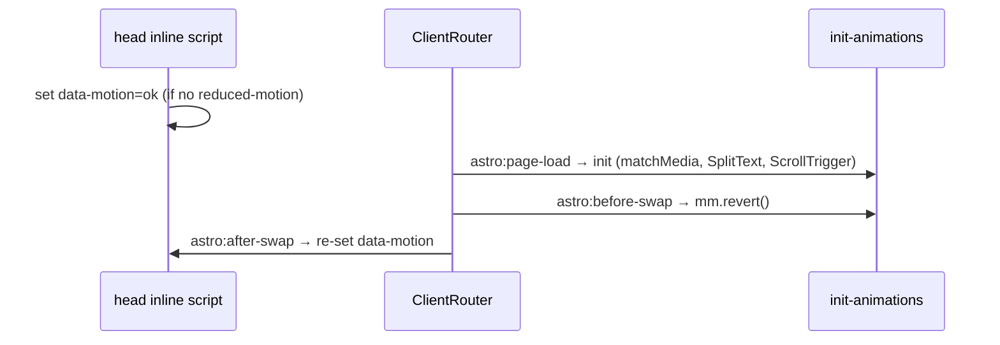

# Phase 08: README & Docs

## Context Links
- Parent: [plan.md](plan.md) · Depends on: [phase-06](phase-06-testing-and-verification.md) (docs describe final code); phase-07 for deployment guide
- Rules: `/home/user/portfolio-app/CLAUDE.md` (docs structure), `/home/user/portfolio-app/.claude/workflows/documentation-management.md`
- Agent at implementation: `docs-manager`

## Overview
- Date: 2026-10-17 · Priority: P1 · Status: Done · Review: Paths + commands verified
- Create README + 7 docs files required by CLAUDE.md. Concise, accurate to code.

## Key Insights
- Repo currently has no README; CLAUDE.md expects one as the entry point.
- Docs must reflect real file paths/commands; write after code stabilizes (DRY: link, don't duplicate).

## Requirements
- Functional: README (what, stack, quick start, scripts, content editing, deploy, placeholder content list); docs files below.
- Non-functional: short, scannable; each file <200 lines.

## Architecture
```
README.md
docs/
├── project-overview-pdr.md     goals, audience, scope v1, non-goals (3D, CMS, light theme), success metrics
├── code-standards.md           kebab-case, <200 lines/file, TS strict, data-attr animation hooks, withBasePath rule, a11y rules
├── codebase-summary.md         directory map + responsibility of each folder/file
├── design-guidelines.md        tokens, type, effects, motion principles, reduced-motion policy, contrast rules
├── deployment-guide.md         Pages setup, workflow, base path, custom domain notes, troubleshooting
├── system-architecture.md      build pipeline, page/component tree, animation lifecycle (mermaid)
└── project-roadmap.md          v1 done items, v2 ideas (Three.js hero, contact form, blog, light theme)
```

Animation lifecycle diagram for system-architecture.md:


## Related Code Files
Create:
- `/home/user/portfolio-app/README.md`
- `/home/user/portfolio-app/docs/project-overview-pdr.md`
- `/home/user/portfolio-app/docs/code-standards.md`
- `/home/user/portfolio-app/docs/codebase-summary.md`
- `/home/user/portfolio-app/docs/design-guidelines.md`
- `/home/user/portfolio-app/docs/deployment-guide.md`
- `/home/user/portfolio-app/docs/system-architecture.md`
- `/home/user/portfolio-app/docs/project-roadmap.md`

## Implementation Steps
1. Read `documentation-management.md` workflow for conventions.
2. Write README.
3. Write 7 docs files from final code (verify every path/command exists).
4. Update `plan.md` phase statuses.

## Todo List
- [x] README.md
- [x] 7 docs files
- [x] Path/command accuracy check
- [x] plan.md statuses updated

## Success Criteria
- Every command in README runs successfully.
- Every path in docs exists.
- New contributor can edit content + deploy using README alone.

## Risk Assessment
- Docs drift from code → write last; codebase-summary generated from actual tree.

## Security Considerations
- No credentials, internal hosts, or personal data beyond what the site publishes.

## Next Steps
- User review → (on request) commit/push → deploy.
- v2 candidates in roadmap.
